<div align="center">

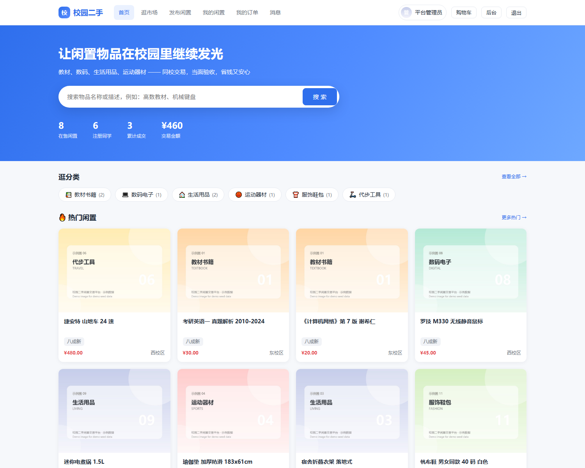

# 校园二手闲置交易平台

**发闲置、在线担保付款、确认收货才结算——一个平台把校园二手交易串成闭环。**

卖家不用再在班级群里刷屏甩卖、反复解释「还在不在」；
买家不用怕钱转过去对方不发货；
管理员不用手工翻表核对谁挂了违规商品、谁的钱还压在平台。

[](https://openjdk.org/projects/jdk/17/)
[](https://spring.io/projects/spring-boot)
[](https://www.mysql.com/)
[](https://redis.io/)
[](https://www.rabbitmq.com/)
[](#六质量与验证)
[](#六质量与验证)

[三分钟跑起来](#四三分钟跑起来) · [界面速览](#三界面速览) · [技术亮点](#五技术亮点) ·
[**功能清单与评分对照**](docs/01-功能清单与评分对照.md) · [**Linux 部署说明**](docs/03-部署文档.md)

</div>

---

## 一、这是什么

一个**面向高校校园**的二手闲置交易平台：用户发布闲置 → 管理员审核上架 → 买家浏览检索 →
在线担保支付（钱先进平台托管）→ 线下交付 → 买家确认收货 → 平台把托管款结算给卖家。

它不是「增删改查练习」：订单是状态机（待支付 / 已支付待交付 / 已完成 / 已取消），资金是闭环的
（进托管、出托管都落库留痕），越权与并发都在服务端兜底（[怎么验证的](#六质量与验证)）。

> **除了代码，还有几份材料必看**：
> [功能清单与评分对照](docs/01-功能清单与评分对照.md)（每项要求对应到哪个类、哪个页面）
> 与 [Linux 部署说明](docs/03-部署文档.md)（JDK / MySQL / Redis / RabbitMQ、systemd、Nginx、排障）。
> 只看 README 会漏掉设计细节和上线步骤。

| 关键数字 | 说明 |
|---|---|
| **3 种角色** | 买家 / 卖家 / 管理员，菜单级 + 接口级 + 数据归属三层校验 |
| **16 张表** | 用户、角色、菜单、分类、物品、图集、留言、收藏、订单、支付流水、审核记录、站内消息、日统计、邮件日志 |
| **30 个页面** | Thymeleaf 服务端渲染，前台 + 后台两套布局，ECharts 本地化（断网可用） |
| **101 个 Java 源文件** | 18 个控制器 / 13 个服务类 / 16 个实体 / 17 个 Mapper，7253 行代码 |
| **50 项冒烟断言** | 一条命令跑完游客 / 买家 / 卖家 / 管理员四类视角；另有全量巡检 51 + 权限回归 14 + 支付链路 15 的历史结论 |

---

## 二、三个角色，各看各的界面

| 角色 | 他能做什么 |
|---|---|
| **买家 / 学生**（`student01`） | 浏览检索（分类 / 关键词 / 价格区间 / 排序 / 分页）；收藏、购物车、浏览记录；下单并在收银台在线支付；确认收货或取消订单；留言咨询与回复；维护资料与头像；站内消息点击跳转并自动已读 |
| **卖家 / 学长**（`seller01`） | 发布闲置（最多 5 张图、成色、原价、校区）；编辑、下架、重新上架、删除；查看「我的闲置」各状态；处理自己物品的留言与订单；收到邮件与站内消息通知 |
| **管理员**（`admin`） | 数据看板（4 张 ECharts）；物品审核 / 驳回 / 违规下架；分类维护；订单与支付流水对账；用户启用禁用与角色分配；留言管理；角色菜单巡检；邮件日志 |

> 演示账号密码：`admin` 为 `admin123`，其余统一 `123456`。完整名单见[附录](#附录测试账号)。

---

## 三、界面速览

### 买家端：检索、下单、付款，一路到底

<table>
  <tr>
    <td width="50%"></td>
    <td width="50%">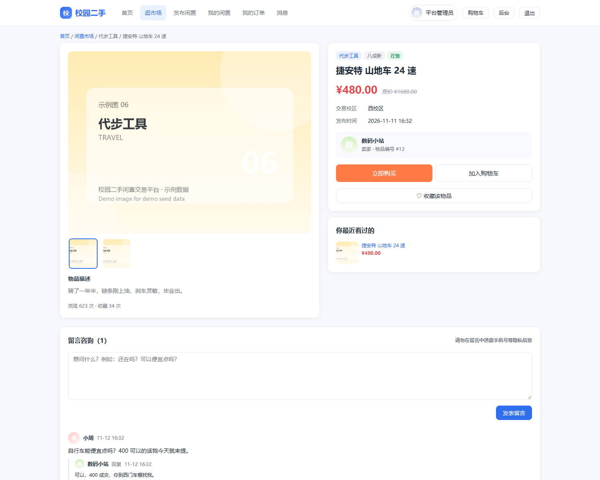</td>
  </tr>
  <tr>
    <td align="center"><sub>分类胶囊带在售数量；热门与最新分区；搜索直达筛选</sub></td>
    <td align="center"><sub>图集、成色、原价对比、卖家信息、留言区、收藏与加入购物车</sub></td>
  </tr>
</table>

### 担保交易：先托管，确认收货才结算

<table>
  <tr>
    <td width="50%">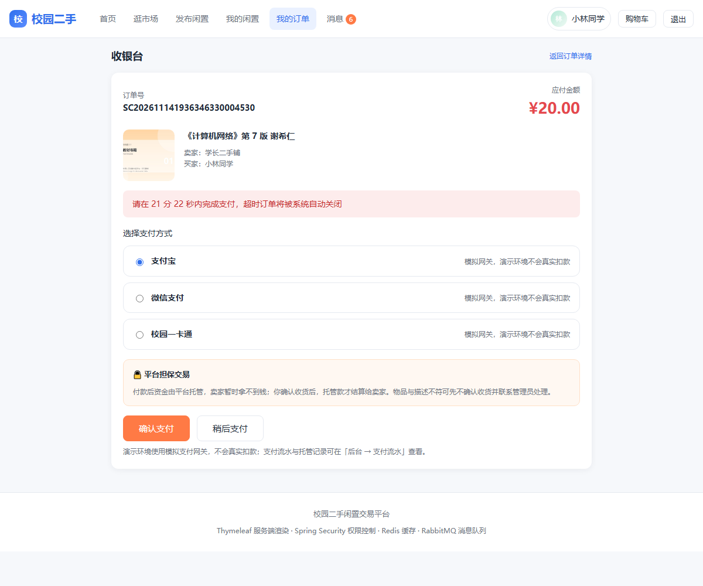</td>
    <td width="50%">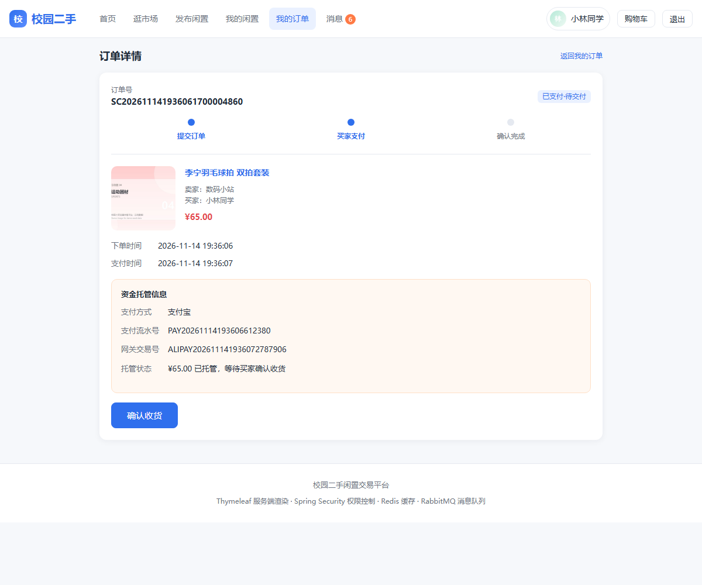</td>
  </tr>
  <tr>
    <td align="center"><sub>三个支付渠道 + 支付倒计时 + 平台担保交易说明</sub></td>
    <td align="center"><sub>支付流水号、网关交易号、托管状态；确认收货后变「已结算给卖家」</sub></td>
  </tr>
</table>

### 管理端：审核、对账、看趋势

<table>
  <tr>
    <td width="50%">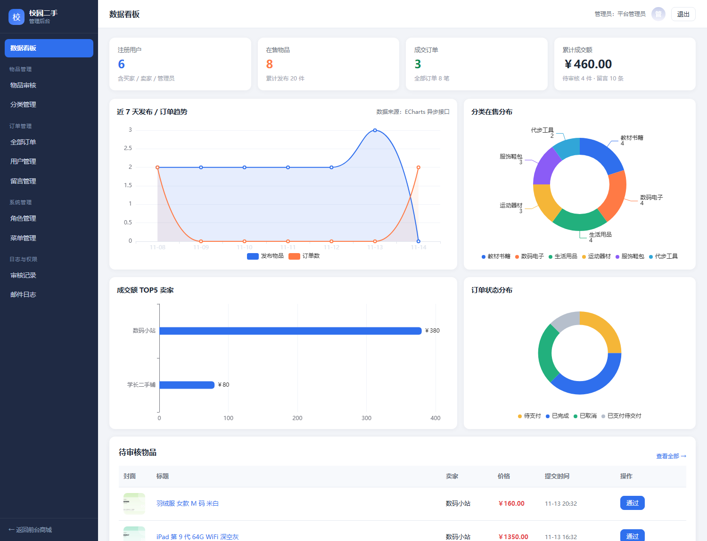</td>
    <td width="50%">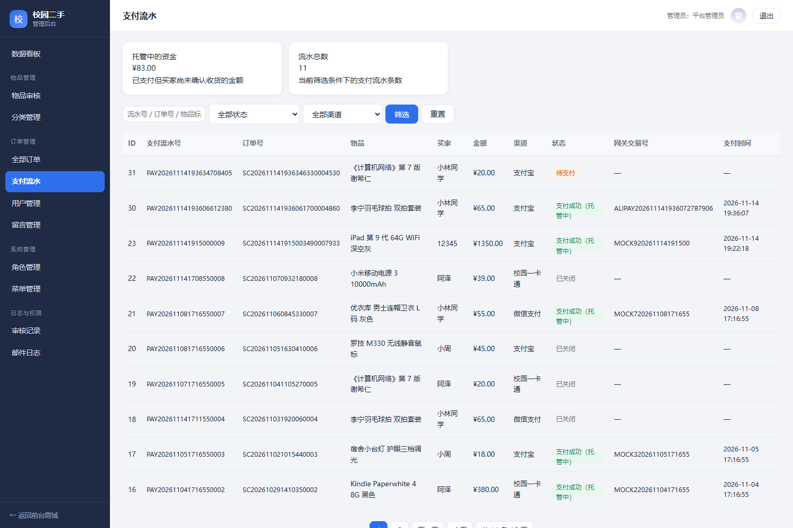</td>
  </tr>
  <tr>
    <td align="center"><sub>发布 / 订单趋势、分类分布、成交额 TOP5、订单状态环形</sub></td>
    <td align="center"><sub>托管中资金、流水筛选、订单状态列；已结算与托管中一眼区分</sub></td>
  </tr>
</table>

<details>
<summary><b>展开看更多界面（审核、分类、订单、用户、消息、邮件日志）</b></summary>

<table>
  <tr>
    <td width="50%">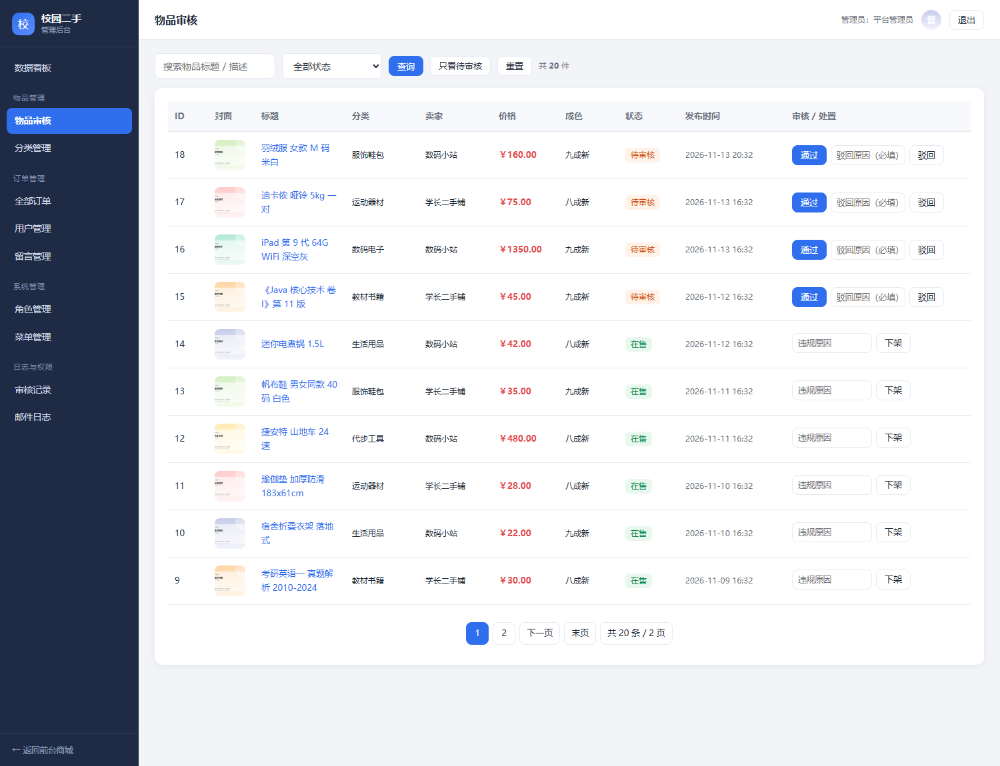</td>
    <td width="50%">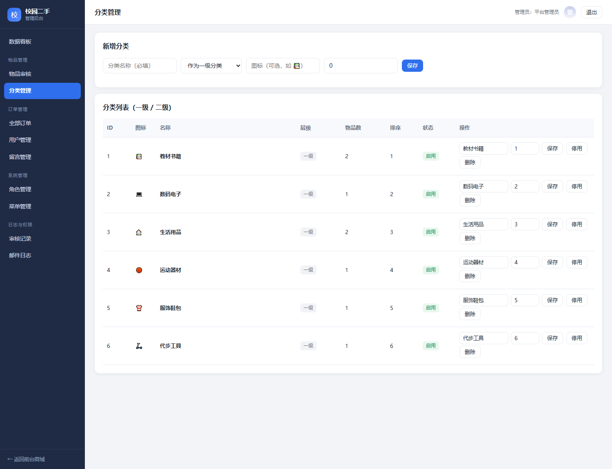</td>
  </tr>
  <tr>
    <td align="center"><sub>待审核通过 / 驳回原因；在售给违规下架；已成交不给下架</sub></td>
    <td align="center"><sub>一级 + 二级分类树、在售数量统计、启停与删除保护</sub></td>
  </tr>
  <tr>
    <td width="50%">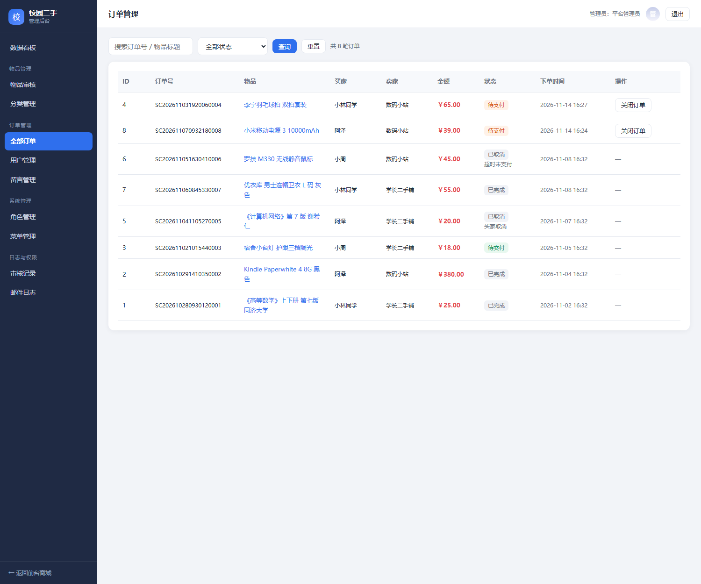</td>
    <td width="50%">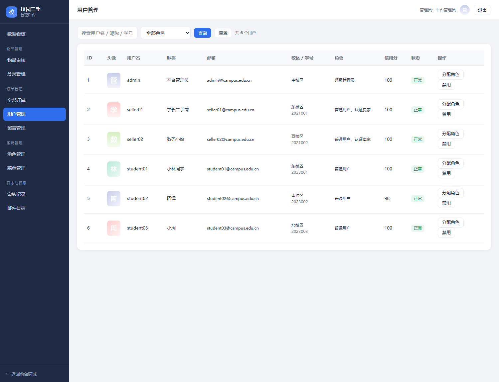</td>
  </tr>
  <tr>
    <td align="center"><sub>按状态筛选、取消原因留痕、待支付可关闭</sub></td>
    <td align="center"><sub>角色标签、信用分、启用禁用、角色分配</sub></td>
  </tr>
  <tr>
    <td width="50%">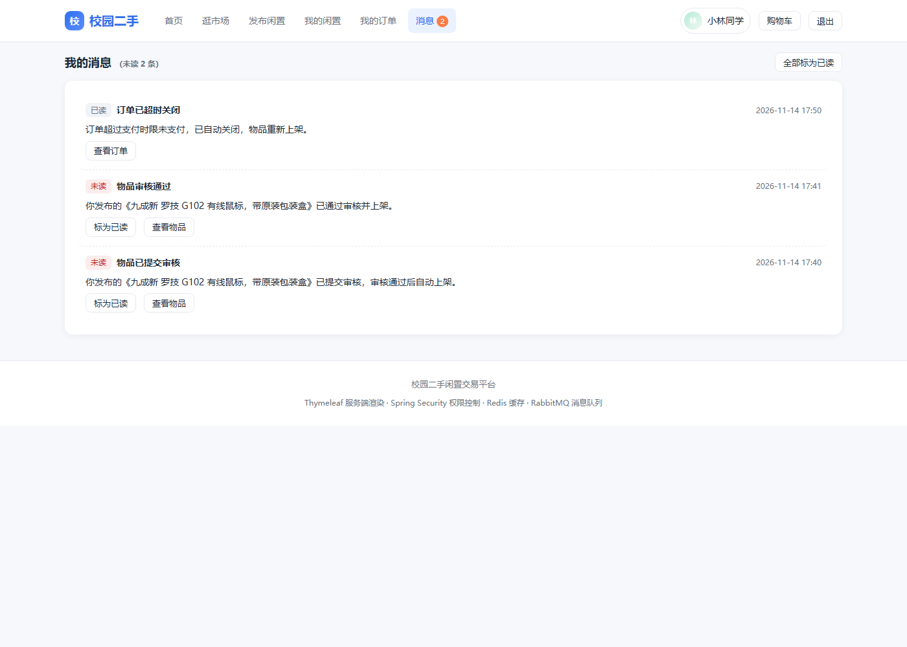</td>
    <td width="50%">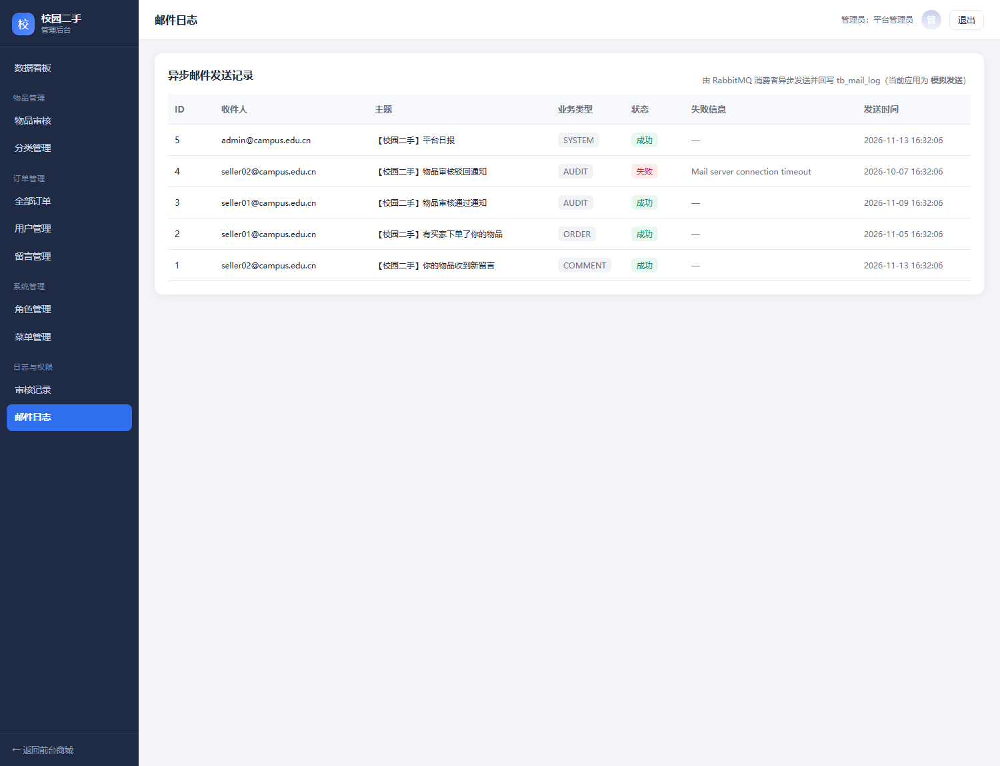</td>
  </tr>
  <tr>
    <td align="center"><sub>未读红点、点击整条即跳转并自动已读</sub></td>
    <td align="center"><sub>每封通知的收件人、业务类型、发送状态与失败原因</sub></td>
  </tr>
</table>

</details>

---

## 四、三分钟跑起来

### 第 1 步：建库（一条命令）

```bash
# 先保证本机 MySQL 8.0 已启动（默认 3306 / root）
mysql -uroot -p --default-character-set=utf8mb4 < sql/01-init.sql
```

> 不想用命令行？把 `sql/01-init.sql` 全文粘进 Navicat / DataGrip 执行也可以。
> 脚本自带 `CREATE DATABASE IF NOT EXISTS campus_secondhand`，建 16 张表并写入演示数据
> （6 个账号、20 件物品、40 张图集、8 笔订单、8 条支付流水）。

### 第 2 步：启动

```bash
# 数据库密码通过环境变量注入（默认 123456，生产务必改）
export MYSQL_PASSWORD=你的root密码        # Windows PowerShell: $env:MYSQL_PASSWORD='你的root密码'

mvn spring-boot:run
# 或者：mvn clean package -DskipTests && java -jar target/campus-secondhand.jar
```

默认 `dev` profile、端口 **8080**。
Redis 用 `127.0.0.1:6379`、RabbitMQ 用 `127.0.0.1:5672`（guest/guest）即可，端口不同就改 `application-dev.yml`。
上传目录默认 `D:/campus-upload/`，**演示图片需先把 `assets/demo/` 下的 18 张图复制进去**，否则列表页是占位图。

### 第 3 步：登录

打开 <http://localhost:8080/login>，用下面任一账号：

| 账号 | 密码 | 角色 | 推荐先看什么 |
|---|---|---|---|
| `student01` | `123456` | 买家 | 逛市场 → 物品「计算机网络 第 7 版」→ 加入购物车或直接下单 → 收银台支付 |
| `seller01` | `123456` | 卖家 | 我的闲置 → 发布闲置（可传 5 张图）→ 等管理员审核 |
| `admin` | `admin123` | 管理员 | 数据看板 → 物品审核（通过刚发布的那件）→ 支付流水对账 |

> 想验证越权防护？用 `student03` 访问别人的订单 `/order/1` 会拿到 403；
> 访问 `/admin/dashboard` 会被重定向到 403 页。细节见[缺陷修复记录](docs/06-缺陷修复记录.md)。

---

## 五、技术亮点

请求链路（单体应用内部）与异步旁路，一张图看完：

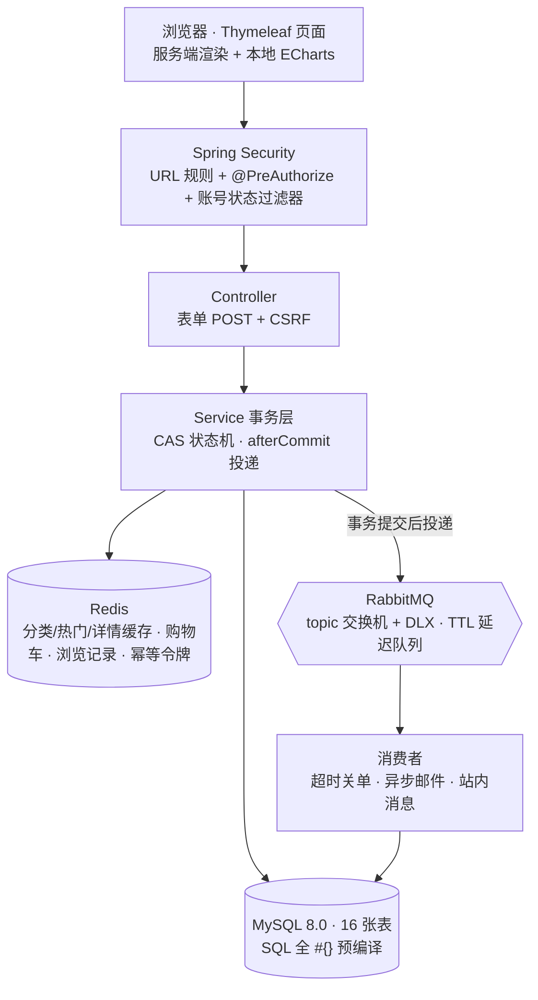

- **担保交易资金闭环**：下单只锁物品（1→5）不动钱；收银台提交后由模拟网关回调做 HMAC-SHA256 验签，
  金额只认服务端订单金额；支付成功把流水 0→1、订单 0→1、物品 5→3；买家确认收货同事务把流水 1→4
  并写 `settle_time`，钱才算「结算给卖家」。7 天不确认收货由定时任务自动完成结算，托管款不会永久挂账。
- **订单幂等与并发**：Redis 令牌防重复提交（同 token 只落一单）+ 物品状态 CAS（`UPDATE ... WHERE status=1`，
  影响 0 行即失败）+ 物品级分布式锁（Lua 比对 token 只删自己持有的锁）。同物品并发抢单只可能成功一单。
- **MQ 三类异步**：TTL + 死信交换机实现「30 分钟未支付自动关单」（延迟队列 → 死信队列 → 关单消费者）；
  审核结果与留言通知走邮件队列；订单与留言状态变化走站内消息队列。消费者手动 ACK、失败不无限重投，
  通知一律在事务 `afterCommit` 投递——回滚不会发出假通知。
- **缓存分层**：分类树 30 分钟、热门物品 5 分钟、物品详情 10 分钟 + 空值占位防穿透；
  浏览量用 Redis 计数、每 20 次原子回写（Lua 实现，兼容 Redis 5.x）；购物车与浏览记录直接放 Redis
  （Hash / ZSet），写路径在事务提交后精确失效。
- **越权三重防线**：URL 规则（`/admin/**` 需 ADMIN）→ 方法注解（`@PreAuthorize`）→ Service 层按登录态校验
  数据归属（他人订单、他人物品、他人消息一律 403）。禁用账号由过滤器在每次请求时强制踢下线。
- **工程化**：全局异常处理按语义返回真实 HTTP 状态码（400/403/404/405/500）、统一响应体 `R<T>`、
  JSR-303 参数校验、日志按天切割、dev / test / prod 三个 profile + `.env` 变量注入、一键部署脚本。

---

## 六、质量与验证

不是「跑起来没报错」，而是**把结论做成可重复的断言**：`scripts/smoke.ps1` 用纯标准库（不需要装任何
Python / Java 依赖）驱动四类角色的登录态，从游客浏览一路跑到管理员后台接口，一条命令出结论。

```bash
# 应用起来后执行（默认 http://127.0.0.1:8080，可用 -BaseUrl 改）
powershell -NoProfile -ExecutionPolicy Bypass -File scripts/smoke.ps1
```

**最近一次运行结果**（四类视角共 50 条断言，全部通过）：

| 视角 | 断言内容 | 结果 |
|---|---|---|
| 游客 | 首页 / 列表 / 关键词与价格筛选 / 详情 / 登录注册 / 静态资源本地化 / 未登录拦截 / 不存在物品 | **13 / 13 PASS** |
| 买家 `student01` | 登录、我的闲置、购物车、收藏、浏览记录、资料、改密、消息、订单列表、发布页、越权访问后台 | **14 / 14 PASS** |
| 卖家 `seller01` | 登录、我的闲置、卖出的订单、发布页 | **4 / 4 PASS** |
| 管理员 `admin` | 登录、12 个后台页面、7 个统计接口（校验 `success=true`） | **19 / 19 PASS** |

另有历史回归结论（逐条见[缺陷修复记录](docs/06-缺陷修复记录.md)）：

| 检查项 | 结果 |
|---|---|
| 全站巡检（游客 11 + 买家 16 + 管理员 22 项页面与接口） | **51 / 51 PASS** |
| 权限与业务回归（可见性、CAS、留言层级、禁用踢线、越权下单） | **14 / 14 PASS** |
| 支付与担保交易链路（流水、订单、物品三方一致、重复支付、超时闸门） | **15 / 15 PASS** |
| 越权与并发验证 | 访客 `/admin/**` → 403；他人订单 → 403；禁用账号下一次请求即被踢；同物品并发下单只成 1 单 |
| 应用日志 | 启动 + 全流程巡检结束，**ERROR = 0** |

> 断言不只看 HTTP 状态码：权限与支付类断言会回查数据库（订单条数、流水状态、收藏明细与计数），
> 避免「页面提示成功但数据没落库」这种假通过。

---

## 七、文档导航

代码之外还有几份材料，**答辩、部署、复现**分别看它们：

| 文档 | 里面写了什么 | 什么时候看 |
|---|---|---|
| [**功能清单与评分对照**](docs/01-功能清单与评分对照.md) | 100 分维度拆解、B1–B6 / A1–A5 / H1–H6 逐条落点、答辩验收清单 | 想知道「哪条要求对应哪个类」，或答辩前自查 |
| [**数据库设计说明**](docs/02-数据库设计说明.md) | 16 张表字段表、索引设计理由、快照冗余与逻辑删除的取舍、自检 SQL | 要改表结构或讲设计思路 |
| [**Linux 部署说明**](docs/03-部署文档.md) | JDK / MySQL / Redis / RabbitMQ 安装、环境变量、systemd、Nginx 反代、验证清单与故障排查 | 要把它部署到服务器（宝塔同理） |
| [**答辩要点与演示脚本**](docs/04-答辩要点与演示脚本.md) | 演示脚本、高频问答、亮点怎么讲 | 答辩前过一遍 |
| [**缺陷修复记录**](docs/06-缺陷修复记录.md) | 32 类缺陷的现象 / 根因 / 改法 / 回归结论 | 被问「遇到过什么问题」时最有说服力 |

其他物料：`deploy/` 下有 `nginx.conf`、`campus-secondhand.service`、`start.sh / stop.sh / restart.sh / init-db.sh`
与 `.env.example`；`assets/demo/` 是演示图片。

---

## 八、项目结构

```text
campus-secondhand/
├── pom.xml                        # Spring Boot 2.7.18 / JDK 17 / 单图 5MB、单次 25MB
├── sql/01-init.sql                # 建库建表 + 演示数据（BCrypt 密文，自包含、可重复执行）
├── docs/
│   ├── 01-功能清单与评分对照.md
│   ├── 02-数据库设计说明.md
│   ├── 03-部署文档.md
│   ├── 04-答辩要点与演示脚本.md
│   ├── 06-缺陷修复记录.md
│   └── screenshots/               # README 用的真机截图
├── deploy/                        # nginx.conf / systemd unit / 启停脚本 / .env.example
├── assets/demo/                   # 18 张演示图（复制到上传目录即可用）
├── src/main/java/com/campus/secondhand/
│   ├── common/                    # 常量、统一响应 R、全局模型
│   ├── config/                    # Security / Redis / RabbitMQ / MyBatis-Plus
│   ├── controller/                # 前台 + admin 子包，共 18 个
│   ├── service/                   # 事务、缓存、MQ 投递、状态机都在这一层（13 个）
│   ├── mapper/ entity/ dto/ vo/   # SQL 全 #{} 预编译；出参过滤敏感字段
│   ├── mq/                        # 延迟关单 / 邮件 / 站内消息 三个消费者
│   ├── task/                      # 超时关单补偿 / 每日统计 / 自动结算
│   └── security/ utils/ exception/
├── src/main/resources/
│   ├── application.yml + -dev/-test/-prod.yml
│   ├── templates/                 # Thymeleaf：2 个片段 + 30 个页面 + 4 封邮件模板
│   └── static/                    # 本地化 ECharts + app.css / admin.css / app.js
├── scripts/smoke.ps1              # 冒烟测试：四类视角 50 条断言（纯标准库，无需额外依赖）
└── src/test/java/                 # 预留测试目录
```

---

## 九、几个需要知道的取舍

- **支付是「模拟网关」不是真接支付宝**：没有商户号与备案域名，所以用同一套语义实现回调验签（HMAC-SHA256）、
  流水表与托管结算；接真渠道时只替换 `PaymentService#confirm` 里的网关调用与密钥即可。
- **视图层锁定 Thymeleaf**（刻意选服务端渲染，不引入 Vue/React）：写操作走普通表单 POST 并带 CSRF 令牌，
  只有 ECharts 的图表数据是 GET JSON 接口；ECharts、样式、脚本全部本地化，断网也能打开页面。
- **邮件默认 mock**（`app.mail.mock=true`）：dev 只渲染模板并记 `tb_mail_log`，不真发；
  配好 SMTP 后把 `MAIL_MOCK=false` 即可真发，日志里能看到成功 / 失败与原因。
- **物品状态与订单状态是两套状态机**：物品 0 待审核 / 1 在售 / 2 已下架 / 3 已售出 / 4 驳回 / 5 交易中；
  订单 0 待支付 / 1 已支付待交付 / 2 已完成 / 3 已取消。下单锁物品（1→5）、支付才置售出（5→3）、
  取消或超时回滚（5→1）——这样既不会一件物品卖两次，也不会出现「下架了却还有未完成订单」。

---

## 附录：测试账号

<details>
<summary><b>展开完整账号清单（6 个：1 管理员 + 2 卖家 + 3 学生）</b></summary>

**管理员**

| 账号 | 昵称 | 说明 |
|---|---|---|
| `admin` / `admin123` | 平台管理员 | 审核、分类、订单、支付流水、用户与角色、邮件日志 |

**卖家**

| 账号 | 昵称 | 校区 | 主要物品 |
|---|---|---|---|
| `seller01` / `123456` | 学长二手铺 | 东校区 | 教材、球拍、台灯等 10 件 |
| `seller02` / `123456` | 数码小站 | 西校区 | 数码、Kindle、移动电源等 10 件 |

**学生（买家）**

| 账号 | 昵称 | 校区 | 演示用途 |
|---|---|---|---|
| `student01` / `123456` | 小林同学 | 东校区 | 主演示账号：下单、支付、确认收货、留言、收藏 |
| `student02` / `123456` | 阿泽 | 南校区 | 演示「两人抢同一件物品」的并发 |
| `student03` / `123456` | 小周 | 北校区 | 演示越权（访问他人订单得 403） |

库内密码均为 BCrypt 密文，明文见上表。

</details>

<div align="center">
<sub>如果这个项目对你有帮助，欢迎点个 Star；问题与建议请提 Issue。</sub>
</div>